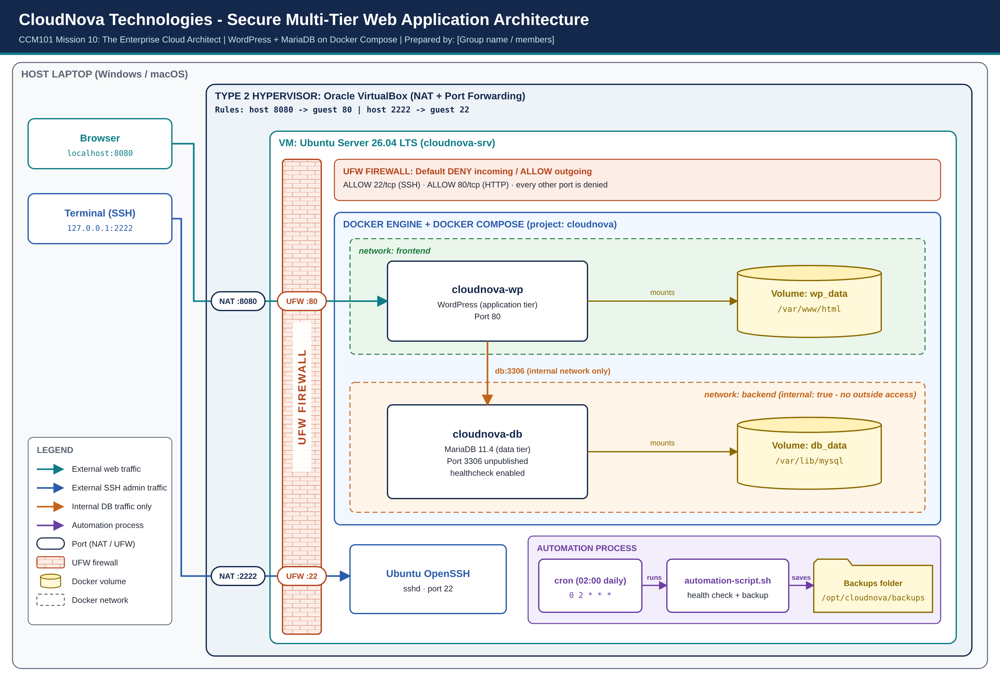

# Laboratory 10 – Mission 10: The Enterprise Cloud Architect
> *Secure, automated, multi-tier web application for CloudNova Technologies*

## 👥 Group Information
- **Members:** ALMEDA, JOHN NELLEY L., AQUINO, SHEDRICK C., LEMON, JAMES PATRICK T., SALVADOR, JORIZ C.
- **Course/Section:** CCM101 – BSIT 4H
- **Instructor:** TORRES, JENKIELYN C.
- **School Year:** 2026-2027

## 📌 Project Summary
| Item | Details |
|------|---------|
| Project | Secure Multi-Tier Web Application |
| Application stack | WordPress (application tier) + MariaDB 11.4 (data tier) |
| Platform | Oracle VirtualBox → Ubuntu Server 26.04 LTS VM (`cloudnova-srv`), headless |
| Orchestration | Docker Engine + Docker Compose v2 (Infrastructure as Code) |
| Security | UFW default deny incoming; only 22/tcp (SSH, rate-limited) and 80/tcp (HTTP) allowed |
| Automation | `automation-script.sh` – health check + backups, scheduled by cron daily at 02:00 |

## 🗺️ Architecture


- Browser → `localhost:8080` → VirtualBox NAT → UFW `:80` → `cloudnova-wp:80`
- Terminal → `127.0.0.1:2222` → VirtualBox NAT → UFW `:22` → Ubuntu OpenSSH
- `cloudnova-wp` → `db:3306` on the **internal** backend network only (database port is never published)
- Data persists in the named volumes `wp_data` and `db_data`

The editable source is [`architecture-diagram.drawio`](architecture-diagram.drawio) (open at app.diagrams.net).

## 📂 Folder Contents
| File | Purpose |
|------|---------|
| [`docker-compose.yml`](docker-compose.yml) | Defines both containers, the two networks and the two volumes |
| [`automation-script.sh`](automation-script.sh) | Health check, database dump, files archive, 7-day retention, disk check |
| [`operational-manual.md`](operational-manual.md) | How to deploy, secure, maintain and recover the system |
| [`final-reflection.md`](final-reflection.md) | Our reflection on Missions 1 to 10 |
| [`.env.example`](.env.example) | Template for the passwords file (the real `.env` is never committed) |
| [`.gitignore`](.gitignore) | Keeps `.env`, backups and local overrides out of GitHub |
| [`screenshots/`](screenshots/) | Evidence of each requirement |

## 🚀 Quick Start
```bash
git clone https://github.com/shedrick-aquino/cloud-computing-course.git
cd cloud-computing-course/Laboratory-10-Enterprise-Cloud-Architect
cp .env.example .env && nano .env      # set strong passwords
chmod 600 .env
docker compose up -d
docker compose ps                      # both Up, db (healthy)
```
Full steps, firewall setup, cron scheduling and recovery are in the [operational manual](operational-manual.md).

## 🔒 Security Summary
```text
Status: active
Default: deny (incoming), allow (outgoing)
22/tcp   LIMIT IN   Anywhere   # SSH admin (rate-limited)
80/tcp   ALLOW IN   Anywhere   # HTTP WordPress
```
Docker-published ports can bypass UFW, so the database publishes **no port** and sits on a network marked `internal: true`.

## 🛠️ Tools Used
VirtualBox, Ubuntu Server, Docker, Docker Compose, UFW, cron, draw.io, KillerCoda, GitHub. [Add any AI assistance here if your instructor requires disclosure.]
