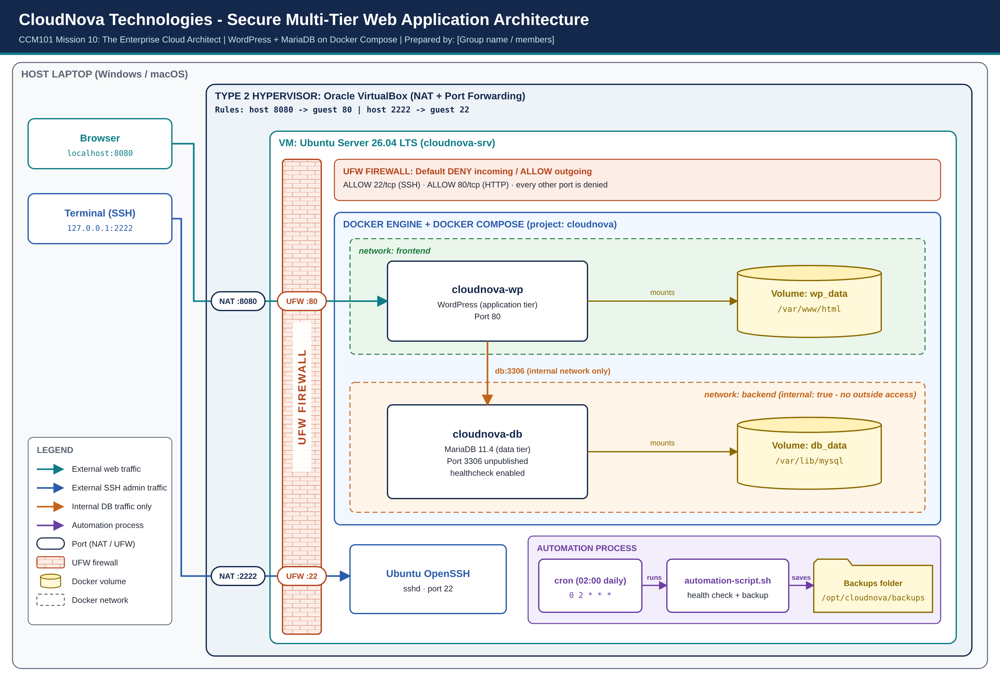

# CCM101 – Cloud Computing
## Enterprise Cloud Architect – Operational Manual

**Project:** Secure Multi-Tier Web Application
**Application Stack:** WordPress + MariaDB
**Prepared by:** [Member 1] | [Member 2] | [Member 3] | [Member 4] | [Member 5]
**Section:** BSIT 4H
**Instructor:** TORRES, JENKIELYN C.
**Date:** November 2026

---

## Table of Contents
1. Executive Summary
2. System Architecture
3. System Requirements
4. Deployment Procedure
5. Security Configuration
6. Automation and Backups
7. Disaster Recovery
8. Routine Maintenance
9. Troubleshooting
10. Verification Checklist and Command Reference

---

## 1. Executive Summary

The CloudNova Enterprise Portal is a two-tier web application: WordPress serves the website and MariaDB stores its data. Both run as Docker containers on a headless Ubuntu Server, defined in a single `docker-compose.yml` file so the whole system can be rebuilt on any server in minutes.

The system is **secure by default**: the UFW firewall denies all incoming traffic except SSH and HTTP, and the database is never exposed outside the server. It is **resilient**: data lives in persistent volumes and containers restart automatically. It is **self-maintaining**: a scheduled script checks container health and takes nightly backups that can be restored in under a minute.

---

## 2. System Architecture



| Layer | Component | Details |
|-------|-----------|---------|
| Host | Laptop (Windows / macOS) | Runs the hypervisor, browser and SSH client |
| Hypervisor | Oracle VirtualBox (Type 2) | NAT with port forwarding: host 8080 → guest 80, host 2222 → guest 22 |
| Server | Ubuntu Server 26.04 LTS VM | Hostname `cloudnova-srv`, 2 vCPU, 4 GB RAM, 25 GB disk |
| Firewall | UFW | Deny incoming; allow 22/tcp (limited) and 80/tcp |
| App tier | `cloudnova-wp` | `wordpress:latest`, port 80, network `frontend` + `backend` |
| Data tier | `cloudnova-db` | `mariadb:11.4`, port 3306 **not published**, network `backend` only |
| Storage | Volumes `wp_data`, `db_data` | `/var/www/html` and `/var/lib/mysql` |
| Automation | cron + `automation-script.sh` | Daily 02:00; backups in `/opt/cloudnova/backups` |

**Traffic flows**
- Users: Browser → `localhost:8080` → NAT → UFW `:80` → `cloudnova-wp:80`
- Administrators: `ssh -p 2222 user@127.0.0.1` → NAT → UFW `:22` → OpenSSH
- Internal only: `cloudnova-wp` → `db:3306` → `cloudnova-db`

---

## 3. System Requirements

**Host machine**
- 64-bit CPU with virtualization (Intel VT-x / AMD-V) enabled in BIOS
- 8 GB RAM or more (4 GB is given to the VM), 30 GB free disk
- Oracle VirtualBox 7.x

**Server (VM)**
- Ubuntu Server 26.04 LTS (24.04 LTS also works), with OpenSSH Server
- Docker Engine and the Docker Compose plugin from Docker's official repository
- Internet access to download packages and container images

**Network ports**

| Port | Purpose | Exposure |
|------|---------|----------|
| 22/tcp | SSH administration | Allowed, rate-limited |
| 80/tcp | WordPress website | Allowed |
| 3306/tcp | MariaDB | Internal Docker network only |
| All others | – | Denied |

---

## 4. Deployment Procedure

### 4.1 Prepare the virtual machine
1. In VirtualBox create a VM named `cloudnova-srv`: Linux / Ubuntu (64-bit), 2 CPUs, 4096 MB RAM, 25 GB disk.
2. Settings → Network → Adapter 1: **NAT** → Advanced → Port Forwarding, add:
   - `ssh`: TCP, host IP 127.0.0.1, host port 2222 → guest port 22
   - `http`: TCP, host IP 127.0.0.1, host port 8080 → guest port 80
3. Install Ubuntu Server. Set hostname `cloudnova-srv`, create an admin user, and tick **Install OpenSSH server**. Do not select the Docker snap.
4. After the first boot:
```bash
sudo apt update && sudo apt full-upgrade -y
sudo timedatectl set-timezone Asia/Manila
sudo apt install -y git nano curl ufw
sudo reboot
```
5. From the host, connect with `ssh -p 2222 <user>@127.0.0.1`.

### 4.2 Install Docker Engine and Docker Compose
```bash
sudo apt install -y ca-certificates curl
sudo install -m 0755 -d /etc/apt/keyrings
sudo curl -fsSL https://download.docker.com/linux/ubuntu/gpg -o /etc/apt/keyrings/docker.asc
sudo chmod a+r /etc/apt/keyrings/docker.asc
sudo tee /etc/apt/sources.list.d/docker.sources <<EOF
Types: deb
URIs: https://download.docker.com/linux/ubuntu
Suites: $(. /etc/os-release && echo "${UBUNTU_CODENAME:-$VERSION_CODENAME}")
Components: stable
Architectures: $(dpkg --print-architecture)
Signed-By: /etc/apt/keyrings/docker.asc
EOF
sudo apt update
sudo apt install -y docker-ce docker-ce-cli containerd.io docker-buildx-plugin docker-compose-plugin
sudo systemctl enable --now docker
sudo usermod -aG docker $USER      # log out and back in afterwards
docker --version && docker compose version
```

### 4.3 Deploy the application
```bash
sudo mkdir -p /opt/cloudnova/backups && sudo chown -R $USER:$USER /opt/cloudnova
git clone https://github.com/shedrick-aquino/cloud-computing-course.git ~/cloud-computing-course
cd ~/cloud-computing-course/Laboratory-10-Enterprise-Cloud-Architect
cp .env.example .env
nano .env                 # replace both passwords with strong ones
chmod 600 .env
docker compose config -q && echo "Compose file OK"
docker compose up -d
docker compose ps         # cloudnova-wp Up, cloudnova-db Up (healthy)
```
Open `http://localhost:8080` on the host, complete the WordPress installer (site title, admin user, strong password, email), and log in at `/wp-admin`.

**What the compose file guarantees**
- `restart: unless-stopped` – containers return after a crash or reboot.
- `depends_on: condition: service_healthy` – WordPress starts only after MariaDB passes its health check.
- `${DB_PASSWORD:?...}` – Compose refuses to start if `.env` is missing, so no default passwords are ever used.

### 4.4 Deploying on a fresh cloud server (KillerCoda)
The same files deploy unchanged on any Ubuntu server. On a KillerCoda Ubuntu playground (logged in as root):
```bash
docker --version || curl -fsSL https://get.docker.com | sh
git clone https://github.com/shedrick-aquino/cloud-computing-course.git
cd cloud-computing-course/Laboratory-10-Enterprise-Cloud-Architect
cp .env.example .env
sed -i "s/^DB_ROOT_PASSWORD=.*/DB_ROOT_PASSWORD=$(openssl rand -hex 16)/" .env
sed -i "s/^DB_PASSWORD=.*/DB_PASSWORD=$(openssl rand -hex 16)/" .env
chmod 600 .env
cat > docker-compose.override.yml <<'EOF'
services:
  wordpress:
    environment:
      WORDPRESS_CONFIG_EXTRA: "$$_SERVER['HTTPS'] = 'on';"
EOF
docker compose up -d
```
KillerCoda publishes the site through its own HTTPS link (menu → **Traffic / Ports** → port 80 → Access). The override file tells WordPress it is served over HTTPS; it is created only on KillerCoda and is excluded by `.gitignore`. Sessions last one hour and are wiped when they end.

---

## 5. Security Configuration

### 5.1 Firewall (UFW)
Always allow SSH **before** enabling the firewall, or you will lock yourself out.
```bash
sudo ufw default deny incoming
sudo ufw default allow outgoing
sudo ufw limit 22/tcp comment 'SSH admin (rate-limited)'
sudo ufw allow 80/tcp comment 'HTTP WordPress'
sudo ufw logging on
sudo ufw enable
sudo ufw status verbose
```
- **Default deny:** anything not explicitly allowed is blocked.
- **limit 22/tcp:** blocks an address that opens 6 or more SSH connections within 30 seconds (basic brute-force protection).
- **No 443:** HTTPS is not served in this deployment; unused ports stay closed.

### 5.2 Database isolation
Ports published by Docker bypass UFW rules, because Docker writes its own iptables rules. The design closes this gap:
- `cloudnova-db` has **no `ports:` section**, so nothing is published.
- The `backend` network is `internal: true`: no route in or out of the server.
- Only `cloudnova-wp` is attached to `backend`, so it is the only client of the database.

Verify:
```bash
docker port cloudnova-db                                        # prints nothing
sudo ss -tulpn | grep 3306                                      # prints nothing
docker network inspect cloudnova_backend -f '{{.Internal}}'     # true
```

### 5.3 Secrets
- Passwords live only in `.env` (permission `600`); the repository holds `.env.example`.
- `.gitignore` blocks `.env`, backups and local overrides from being committed.
- The backup script reads the database password from inside the container; it never stores it.

### 5.4 Optional hardening
```bash
echo "PermitRootLogin no" | sudo tee /etc/ssh/sshd_config.d/99-hardening.conf
sudo systemctl restart ssh
sudo apt install -y unattended-upgrades && sudo dpkg-reconfigure -plow unattended-upgrades
```

---

## 6. Automation and Backups

### 6.1 What the script does
`automation-script.sh` runs as root and performs five tasks, logging each to `/var/log/cloudnova-backup.log`:

| Step | Task | Result |
|------|------|--------|
| 1 | Health check | Starts any container that is not running |
| 2 | Database backup | `mariadb-dump --all-databases --single-transaction` → `db_<timestamp>.sql.gz` |
| 3 | Files backup | Archives the `wp_data` volume → `wp_<timestamp>.tar.gz` |
| 4 | Retention | Deletes backups older than 7 days |
| 5 | Disk check | Warns when disk usage reaches 80% |

### 6.2 Install and test
```bash
sudo mkdir -p /opt/cloudnova
sudo cp automation-script.sh /opt/cloudnova/
sudo chmod +x /opt/cloudnova/automation-script.sh
sudo /opt/cloudnova/automation-script.sh
ls -lh /opt/cloudnova/backups
sudo tail -n 20 /var/log/cloudnova-backup.log
```

### 6.3 Schedule with cron
```bash
sudo crontab -e
# add this line:
0 2 * * * /opt/cloudnova/automation-script.sh >> /var/log/cloudnova-cron.log 2>&1
sudo crontab -l
systemctl status cron
```
`0 2 * * *` = minute 0, hour 2, every day, every month, every weekday: 02:00 daily, the lowest-traffic period.

---

## 7. Disaster Recovery

Use the newest files in `/opt/cloudnova/backups` (`ls -lt`).

**Restore the database**
```bash
gunzip -c /opt/cloudnova/backups/db_<timestamp>.sql.gz | docker exec -i cloudnova-db \
  sh -c 'exec mariadb -uroot -p"$MARIADB_ROOT_PASSWORD"'
```

**Restore the WordPress files (themes, plugins, uploads)**
```bash
cd ~/cloud-computing-course/Laboratory-10-Enterprise-Cloud-Architect
docker compose stop wordpress
docker run --rm -v cloudnova_wp_data:/data -v /opt/cloudnova/backups:/backup alpine \
  sh -c "rm -rf /data/* && tar xzf /backup/wp_<timestamp>.tar.gz -C /data"
docker compose start wordpress
```

**Verify:** open the site and confirm that recent posts and media are present.

**Full server loss:** deploy on a new server (Section 4), copy the latest backup files into `/opt/cloudnova/backups`, then run both restore procedures.

---

## 8. Routine Maintenance

| Frequency | Task | Command |
|-----------|------|---------|
| Daily | Check service status | `docker compose ps` |
| Daily | Review backup log | `sudo tail -n 30 /var/log/cloudnova-backup.log` |
| Weekly | Apply OS updates | `sudo apt update && sudo apt upgrade -y` |
| Weekly | Check disk space | `df -h && docker system df` |
| Monthly | Update container images | `docker compose pull && docker compose up -d` |
| Monthly | Remove unused images | `docker image prune -f` |
| Monthly | Test a restore | Section 7 |
| Quarterly | Review firewall and rotate passwords | `sudo ufw status numbered`; update `.env`, then the database users |

Before updating images, run the backup script once so a rollback point exists.

---

## 9. Troubleshooting

| Symptom | Likely cause | Fix |
|---------|--------------|-----|
| Site not reachable at `localhost:8080` | Missing port-forward rule, UFW blocking 80, or container down | Check VirtualBox port forwarding, `sudo ufw status`, `docker compose ps` |
| "Error establishing a database connection" | Database still starting, or passwords changed after first run | Wait for `(healthy)`; restore the original passwords in `.env` |
| Compose says "Set DB_PASSWORD in .env" | `.env` missing | `cp .env.example .env` and set passwords |
| `permission denied ... docker.sock` | User not yet in the docker group | `sudo usermod -aG docker $USER`, then log in again |
| `ssh: connection refused` | OpenSSH missing or port 22 blocked | `sudo apt install openssh-server`; `sudo ufw limit 22/tcp` |
| Locked out after `ufw enable` | SSH not allowed first | Use the VirtualBox console: `sudo ufw allow 22/tcp` |
| Port 80 already in use | Another web server on the host | `sudo systemctl disable --now apache2` or set `WP_PORT` in `.env` |
| Cron job did not run | Script not executable or wrong path | `chmod +x`; use full paths; check `journalctl -u cron` |
| `bash\r: No such file` | Windows line endings | `sed -i 's/\r$//' automation-script.sh` |
| KillerCoda site loads without styling | HTTPS override missing | Create `docker-compose.override.yml` (Section 4.4), then `docker compose up -d` |

---

## 10. Verification Checklist and Command Reference

**Verification checklist**
- [ ] `docker compose ps` shows both containers Up, database healthy
- [ ] Website opens from the host browser
- [ ] Test post survives `docker compose down` / `up -d` and a VM reboot
- [ ] `sudo ufw status verbose` shows deny incoming with only 22 and 80 allowed
- [ ] `docker port cloudnova-db` prints nothing
- [ ] Backup script runs without errors and creates two files
- [ ] `sudo crontab -l` shows the 02:00 job
- [ ] A deleted post is recovered by the restore procedure

**Command reference**

| Task | Command |
|------|---------|
| Start / stop | `docker compose up -d` / `docker compose down` |
| Logs | `docker compose logs -f wordpress` |
| Database console | `docker exec -it cloudnova-db mariadb -uroot -p` |
| Volumes / networks | `docker volume ls` / `docker network ls` |
| Resource usage | `docker stats --no-stream` |
| Firewall | `sudo ufw status verbose` |
| Listening ports | `sudo ss -tulpn` |
| Run backup now | `sudo /opt/cloudnova/automation-script.sh` |
| Copy a file to the host | `scp -P 2222 <user>@127.0.0.1:/path/file .` |

> **Warning:** `docker compose down -v` deletes the volumes and every piece of data in them. Never run it on a live system.
